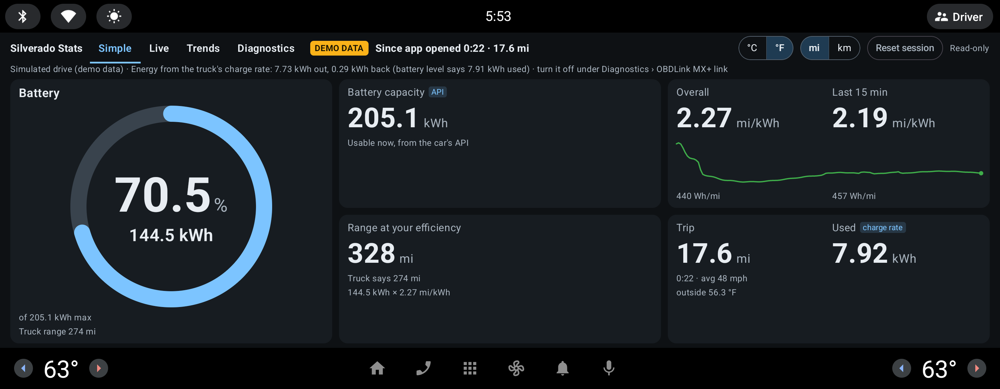
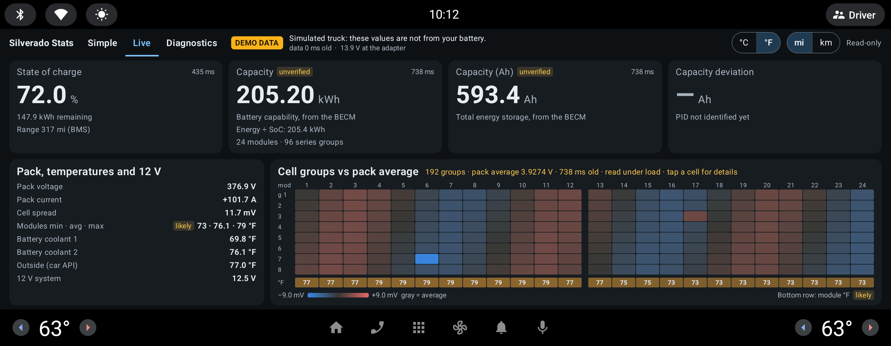
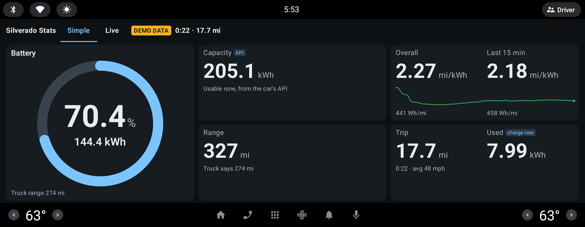

# Silverado Stats

A personal, one-truck Android Automotive app that shows battery data on a 2024 Chevrolet Silverado EV's center screen, plus a read-only Python tool for the laptop. It is for this one truck, on Play internal testing, and never goes beyond that.

- **App:** Play package `com.vincel.silveradoev`, source package `dev.silveradostats`, Gradle root `android/`, module `:app`.
- **Laptop tool:** `tools/probe`, run with the `./probe` wrapper. Without `-t` it talks only to its built-in simulator.

## Current state

**0.5.0 (version code 8) is the MVP**, on the internal track since 2026-11-04; `release/silverado-ev-v8-source.tgz` (git-ignored) holds its exact source. It is 0.4.0 with dead code removed, plus the owner's changes after the first drive: kW readouts removed, capacity on Simple and Live, session energy measured from power in and out, and a Connect/Disconnect MX+ button that also works while driving. None of those changes is confirmed on the truck yet. Tag `v0.4.0` holds the exact source of the last build tested on the truck. 0.6.0 (code 9) added the battery log and Trends tab, and 0.7.0 (code 10, the newest on the internal track; `release/silverado-ev-v10-source.tgz`) the Truck API / MX+ views of Trends; neither has run on the truck.

The owner confirmed on the truck, on 0.4.0: the app stays up in Drive and Live shows real data from the MX+. MX+ pairing from the head unit: owner report 2026-11-04, on the build before 0.4.0; the working Live link on 0.4.0 shows the connection holds. Everything still unconfirmed, such as current sign under load, charging and 12 V drain, is under Open work in [`PLAN.md`](PLAN.md).

Tests: 403 in the app, 50 in the probe. They run on the JVM and the simulator, not on the truck.





These are emulator captures with demo data: Simple from this checkout, Live of 0.5.0. Every screen in `docs/images/` is listed under [Screenshots](#screenshots).

## The hard rule

**Nothing may impair the truck.** Never weaken any of these:
- the read-only allowlists: UDS `0x22`, OBD `03`/`07`/`0A` and `01`/`09`, and the adapter AT allowlist
- the ELM link discipline: no write until the prompt and quiet, no bare CR, no protocol search
- sleep silence: nothing on the bus while the truck sleeps
- the driving lockdown: out of Park, only Simple and Live; the tabs, Simple's layout selector and the Connect/Disconnect MX+ button are the only controls, and there are no tap details

These tests enforce it. If a change makes one fail, the change is wrong, not the test.

| Test | Enforces |
|---|---|
| `SafetyTest` | The app's allowlist: what may be sent, and to which addresses |
| `ElmLinkHardeningTest` | The AT allowlist and ELM link discipline |
| `SourceSafetyTest` | No write calls, GM content providers or foreign binds in the source; the exact permissions; the exact distraction-optimized activities |
| `AndroidWiringTest` | Diagnostics and pairing reachable only in Park; the OBD engine attaches only when `UiSettings.wantsObd` says so; Simple and Live never scroll |
| `DrivingStateTest` | The driving state fails safe |
| `DashLayoutTest` | Every page fits at every window size; driving locks everything else away |
| `PollerSleepTest` | Bus silence while the truck sleeps |
| `tools/probe/tests/test_probe.py` | The same allowlist and ELM discipline in the Python probe |

The Kotlin tests are under `android/app/src/test/kotlin/dev/silveradostats/`. The full safety model is §3 of [`PLAN.md`](PLAN.md).

A command with `-t elm-bt:auto` talks to the real truck. Run those only at the truck, on purpose, as `docs/truck-connection.md` says.

## Working rules

From the owner:
- **Show screens and get an OK before publishing UI changes.** Mockup or screenshots first, then build and publish.
- **Wi-Fi adapters are ruled out.** The OBDLink MX+ over Bluetooth Classic is the only adapter.
- **The truck has no ADB.** Builds reach it only through Play. What the head unit sees comes back only as a photo of the screen or through Send to laptop. Layout work happens on the emulator.
- **Internal testing only, never production.**

## Repo map

### Layout files

The next round of work is layout tweaks. All of this is under `android/app/src/main/kotlin/dev/silveradostats/`.

| File | What it decides |
|---|---|
| `ui/layout/DashLayout.kt` | **Start here.** Pure policy: from window size, driving state and font scale to type sizes, which lines show, grid shapes and chart minimums. `DashLayoutTest` walks every landscape size from 1000 x 420 dp up. |
| `ui/layout/DashWidgets.kt` | The fitting widgets: `FitText`, `FitColumn`, `PriorityRow`, `Segmented`. |
| `ui/AppShell.kt` | The header row and tabs, and the "Available in Park" panel. |
| `ui/simple/SimpleScreen.kt`, `ui/simple/SimpleModel.kt` | The Simple tab; the model is pure and unit tested. |
| `ui/live/LiveScreen.kt`, `ui/live/DashboardModel.kt`, `ui/live/Units.kt` | The Live tab: tiles, Pack card, temperatures, cell heatmap (parked only). |
| `ui/theme/Theme.kt` | Colors and the Material theme. |
| `glance/GlanceModel.kt`, `glance/GlanceScreen.kt` | Battery Glance. Its title and row titles must stay constant, because of the template quota noted in the model. |
| `log/` | The battery log: rows, CSV, the PID catalog and what Trends draws (pure, unit tested), SQLite store, hourly job, MX+ visit. |
| `ui/trends/TrendsScreen.kt` | The Trends tab: one source at a time (Truck API or MX+), capacity tiles, a chart with separate axes, the PID list in groups, range, CSV export. In Park only. |
| `ui/DiagnosticsScreen.kt`, `ui/MxLinkSection.kt` | The Diagnostics tab and MX+ pairing, parked only. |

**Read this before changing layout:** the owner's photo has no "Silverado Stats" title in the header, so the truck's window is narrower than the emulator proxy, or its font is larger. The real window size and font scale aren't known yet. See §5 of [`PLAN.md`](PLAN.md).

### Everything else

| Path | What it is |
|---|---|
| `android/app/src/main/kotlin/dev/silveradostats/obd/` | Kotlin port of the probe: `Safety.kt` (allowlist), `ElmTransport.kt` and `ElmLink.kt` (adapter), `Poller.kt`, `Profile.kt`, `Derive.kt` |
| `.../link/` | `LinkService`, `LinkEngine`, `LinkConnection` (who holds the MX+ and when), `AppSettings` |
| `.../bt/` | Bluetooth Classic discovery, pairing and RFCOMM |
| `.../vehicle/` | Read-only VHAL access, `DrivingState.kt`, `SessionTracker.kt` (measured efficiency), `DemoDrive.kt` |
| `.../report/`, `.../diag/` | The Send to laptop report, permissions, system facts |
| `android/app/src/main/assets/profile.json` | Exported DID profile. Generated; don't edit by hand |
| `android/app/src/test/resources/golden_decode.json` | Python-to-Kotlin parity vectors. Generated |
| `android/scripts/` | `release-bundle.sh`, `gen_golden_decode.py`, `gen_property_catalog.py` |
| `probe` | Wrapper: `./probe <command>`, no install needed |
| `tools/probe/` | The laptop tool: `obd`, `read`, `dtc`, `poll`, `scan`, `export-profile`, `receive` ([its README](tools/probe/README.md)) |
| `tools/probe/dids/silverado_ev.toml` | The shared DID profile, source of truth for the app |
| `tools/setup-android-sdk.sh` | Installs the SDK packages. Run it only with the owner's OK: it installs Google packages under their license |
| `docs/` | See [Docs](#docs) |
| `logs/`, `release/` | **Git-ignored and in no tag.** Session 1's raw logs and the signed bundles exist only here, so never run `git clean -x` |

## Prerequisites

| Item | Where |
|---|---|
| Python 3 | System; the probe uses only the standard library |
| JDK 21 | `~/.local/share/jdks/jdk-21.0.13+9` |
| Android SDK | `~/Android/Sdk`: platform 36, build-tools 36.0.0, platform-tools, emulator, AAOS API 34 and 35 images |
| Upload key | `~/.android-keys/`, outside the repo; never commit or print it |

The owner's shell is fish. The commands below work in fish and bash, except the one marked fish. Android Studio is optional; command-line builds are enough.

## Commands

### App: test, build, lint

Working directory: `android/`.

```bash
env JAVA_HOME=$HOME/.local/share/jdks/jdk-21.0.13+9 ANDROID_HOME=$HOME/Android/Sdk ./gradlew :app:testDebugUnitTest
env JAVA_HOME=$HOME/.local/share/jdks/jdk-21.0.13+9 ANDROID_HOME=$HOME/Android/Sdk ./gradlew :app:assembleDebug
env JAVA_HOME=$HOME/.local/share/jdks/jdk-21.0.13+9 ANDROID_HOME=$HOME/Android/Sdk ./gradlew :app:lintDebug
```

### Release

1. Raise `versionCode` and `versionName` in `android/app/build.gradle.kts`.
2. Working directory: the repo root.
   ```bash
   android/scripts/release-bundle.sh
   ```
   It runs the tests, builds and signs the bundle, prints the version and writes `release/silverado-ev-v<code>.aab`. It stops if that file already exists.
3. Upload it to the regular internal track: [`docs/play-console.md`](docs/play-console.md). The truck updates through its Play Store.

### Probe: tests and simulator

Working directory: `tools/probe/`.

```bash
env PYTHONPATH=src python3 -m unittest discover -s tests -v
```

Working directory: the repo root. No `-t`, so these use the simulator.

```bash
./probe --help
./probe poll --profile tools/probe/dids/silverado_ev.toml --count 1
./probe obd
./probe dtc
./probe read --profile tools/probe/dids/silverado_ev.toml --module becm --did 27C6 27AF
```

### Changing the DID profile

Working directory: the repo root. Edit `tools/probe/dids/silverado_ev.toml`, then export it for the app and regenerate the parity vectors, because `ObdGoldenParityTest` pins the profile's hash.

```bash
./probe export-profile --profile tools/probe/dids/silverado_ev.toml --out android/app/src/main/assets/profile.json
env PYTHONDONTWRITEBYTECODE=1 python3 -B android/scripts/gen_golden_decode.py
```

### Getting data off the truck

Photograph the screen, or use Send to laptop. Send to laptop is untried on this truck. It needs a hotspot both the head unit and the laptop can join (some GM EVs reportedly can't join Wi-Fi: [`docs/play-console.md`](docs/play-console.md)), and the laptop's firewall must allow port 8766.

Working directory: the repo root.

```bash
./probe receive
```

In the app, in Park: Diagnostics › Report, set **Laptop URL** to `http://<laptop-ip>:8766/report`, then **Send to laptop**. Reports land in `logs/reports/`. There is no truck traffic.

## Layout-tweak loop (emulator only)

These commands come from the sessions that made the current screenshots. They were not re-run for this README. Demo data is on by default on an emulator.

Put the SDK tools on your path once (fish, any working directory):

```bash
fish_add_path $HOME/Android/Sdk/platform-tools $HOME/Android/Sdk/emulator
```

**1. Start the emulator.** Any working directory, in a second terminal. Leave out `-no-window` to watch it. Wait until the second command prints `1`.

```bash
emulator -avd silverado_aaos34 -no-window -no-audio -no-snapshot -gpu swiftshader_indirect -no-boot-anim
adb shell getprop sys.boot_completed
```

**2. Set the panel.** Any working directory. This is 2914 x 1134 at 200 dpi, the best public proxy for the 17.7" screen. Also check a narrower window, because the truck's may be (see above); the `-compact` screenshots use `wm size 1408x792` and `wm density 160`.

```bash
adb shell wm size 2914x1134
adb shell wm density 200
```

**3. Build and install.** Working directory: `android/`.

```bash
env JAVA_HOME=$HOME/.local/share/jdks/jdk-21.0.13+9 ANDROID_HOME=$HOME/Android/Sdk ./gradlew :app:assembleDebug
adb install -r -t --user current app/build/outputs/apk/debug/app-debug.apk
adb shell pm grant --user current com.vincel.silveradoev android.car.permission.CAR_ENERGY
adb shell pm grant --user current com.vincel.silveradoev android.car.permission.CAR_SPEED
adb shell pm grant --user current com.vincel.silveradoev android.permission.BLUETOOTH_SCAN
adb shell pm grant --user current com.vincel.silveradoev android.permission.BLUETOOTH_CONNECT
adb shell am start --user current -n com.vincel.silveradoev/dev.silveradostats.MainActivity
```

**4. Inject gear and speed.** Any working directory. `0x11400400` is `GEAR_SELECTION` (8 = Drive, 4 = Park) and `0x11600207` is `PERF_VEHICLE_SPEED` in m/s.

Drive:

```bash
adb shell cmd car_service inject-vhal-event 0x11400400 8
adb shell cmd car_service inject-vhal-event 0x11600207 15
adb shell cmd car_service emulate-driving-state drive
```

Park:

```bash
adb shell cmd car_service inject-vhal-event 0x11600207 0
adb shell cmd car_service inject-vhal-event 0x11400400 4
adb shell cmd car_service emulate-driving-state park
```

If the app doesn't follow, run `adb root` once and set the values in the VHAL as well, with `adb shell dumpsys android.hardware.automotive.vehicle.IVehicle/default --set 0x11400400 -i 8` for the gear and `--set 0x11600207 -f 15` for the speed.

**5. Screenshot.** Working directory: the repo root. The first command prints the display ID that `-d` needs. Let Live run about 3 minutes first, so its charts fill.

```bash
adb shell dumpsys SurfaceFlinger --display-id
adb exec-out screencap -p -d <id> > docs/images/<name>.png
```

**6. Show the screens and get an OK** before publishing anything. After a layout change, refresh the screenshots below.

**7. Clean up.** Any working directory.

```bash
adb shell wm size reset
adb shell wm density reset
adb emu kill
```

### Screenshots

All are emulator captures, in `docs/images/`, with demo data except `glance-builtin.png`: the Simple ones from this checkout, the rest of 0.5.0.

| File | Shows |
|---|---|
| [`simple.png`](docs/images/simple.png) | Simple in Park |
| [`live-park.png`](docs/images/live-park.png) | Live in Park, with the cell heatmap |
| [`diagnostics-park.png`](docs/images/diagnostics-park.png) | Diagnostics in Park |
| [`simple-drive.png`](docs/images/simple-drive.png) | Simple in Drive |
| [`live-drive.png`](docs/images/live-drive.png) | Live in Drive, without the heatmap |
| [`diagnostics-drive.png`](docs/images/diagnostics-drive.png) | The Diagnostics panel out of Park: "Available in Park" |
| [`simple-compact.png`](docs/images/simple-compact.png), [`live-compact.png`](docs/images/live-compact.png) | A smaller window, 1408 x 792 at 160 dpi, with no title in the header |
| [`glance-builtin.png`](docs/images/glance-builtin.png), [`glance-demo.png`](docs/images/glance-demo.png) | Battery Glance: built-in data only, and with demo OBD data |

## Docs

| File | What it is |
|---|---|
| [`PLAN.md`](PLAN.md) | Status, open work, safety model, data map, truck findings, limits and decisions, open risks |
| [`docs/play-console.md`](docs/play-console.md) | Publishing to the internal track and installing on the truck |
| [`docs/truck-connection.md`](docs/truck-connection.md) | Runbook for a laptop session at the truck |
| [`docs/session1-results.md`](docs/session1-results.md) | Dated record of what the truck answered on 2026-11-03 |
| [`docs/research/README.md`](docs/research/README.md) | Index of the research notes, and which recommendations were overtaken |
| [`tools/probe/README.md`](tools/probe/README.md) | The probe's commands, transports and safety gate |
